# Design decision: one display editor at a time

**Status: built, in the desktop editor and in the phone editor.**

The web app has a display editor: the place where the admin decides which widgets the device
shows, and where. It can be opened on a laptop and on a phone. This document is about what
happens when it is open in two places at once, what we decided, and why. The screenshots are of
the app itself.

## The problem

Without any rule, two open editors each hold their own copy of the layout. Whoever saves last
wins, and the other one's saved work disappears without anyone being told. We saw exactly that
in a test with a phone and a laptop.

A second problem sits next to it: work that is not saved yet lives only inside the page. A
closed tab, a dead battery or a lost connection throws it away.

## When can this happen?

We assume **good will and cooperation** between the two sides: they do not want conflicting
things, and nobody means harm. Under that assumption there are two realistic cases.

**Scenario 1: two people share a display.** One of them is editing, on a laptop or a phone.
The other does not know, and opens the editor too.

**Scenario 2: a forgotten editor.** The editor is open on one machine and was forgotten. The
same person now wants to edit from another machine. It can also be another tab or another
browser on the same machine.

The two look the same to the server: an editor is open, and a second one opens. What differs
is whether anyone is still sitting at the first one.

## What others do: WhatsApp Web

WhatsApp Web allows one window at a time. When it is opened in a second window, the new window
is the one in use, and the old one is told so and offered to take the session back.

That fits WhatsApp well, for two reasons that do not hold for us:

- **An account has one user.** Two windows are always the same person, so nobody else's
  wishes are involved.
- **Nothing in a window can be lost.** A message is either sent or it is a few typed words.

A display is different on both counts. **Several people can legitimately manage one display,**
so the other editor may be another person in the middle of something. And **an editor can hold
unsaved work**: a layout that someone has been arranging for ten minutes.

So we kept the core of that idea, one window in use and a way to take over, and added what a
shared display needs: the old editor is asked before its unsaved work is touched.

## The decision

**1. Only one editor is in use at a time. A new editor can take over from the old one.**

**2. Unsaved work is kept on the server, not in the page.** There are two versions of the
layout:

| Version | What it is |
|---|---|
| **Live** | The saved layout. This is what the device shows |
| **Draft** | The layout being worked on, updated on the server with every change |

Saving makes the draft the live layout. Discarding erases the draft.

**3. What happens when a second editor opens depends on whether the first has unsaved work.**

| The first editor | What happens |
|---|---|
| Has nothing unsaved | The new editor takes over at once. The first one is told that another editor is now in use |
| Has unsaved work | The new editor chooses: take over and **continue** that work, take over and **discard** it, or leave. If it takes over, the first editor is asked to **approve or refuse**, with a timer shown on both sides (20 seconds, for now). No answer in time counts as approval |
| Is gone, but left unsaved work behind | The new editor is asked whether to **resume** that work or **discard** it |

**4. An editor that loses its connection to the server stops.** It shows that the connection
was lost and offers to reload. After reloading it is treated as a new editor, by the same
rules.

**5. Leaving the editor with unsaved work asks what should happen to it:** keep it as a draft,
save it, or discard it.

## What it looks like

### A second editor opens while the first has unsaved work

The new editor is told, and chooses. Here it is a phone, which asks on its start screen; a
laptop shows the same message over the editor.

| The new editor, on a phone | The new editor, on a laptop |
|---|---|
| 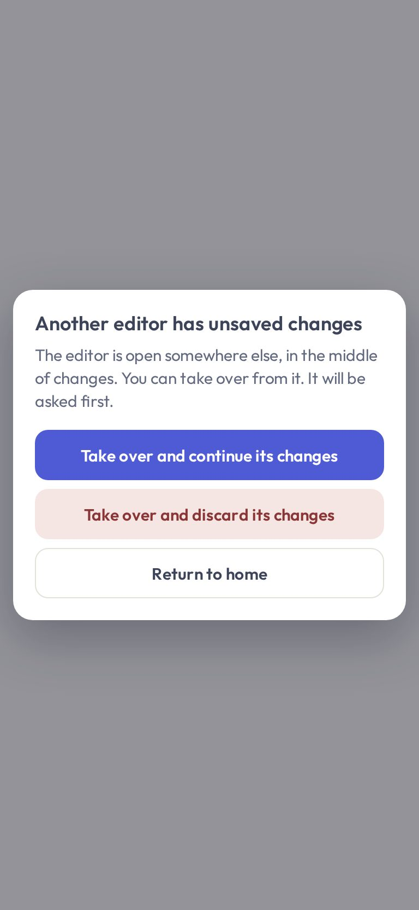 | 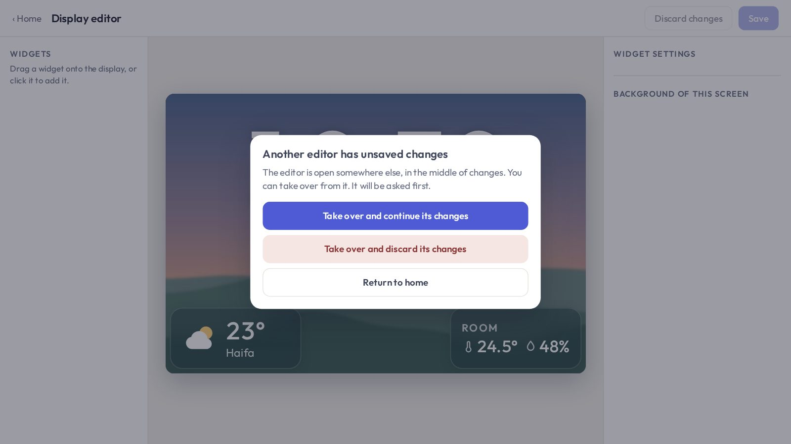 |

If it takes over, it waits, and sees how long:

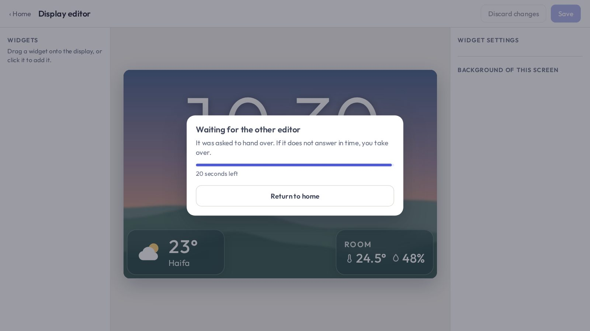

### The first editor is asked

The first editor is asked to approve or refuse. The message says what will happen to its
unsaved work, and the Approve button is purple when nothing is lost and maroon when the work
will be discarded.

| The work will be continued (a laptop) | The work will be discarded (a phone) |
|---|---|
| 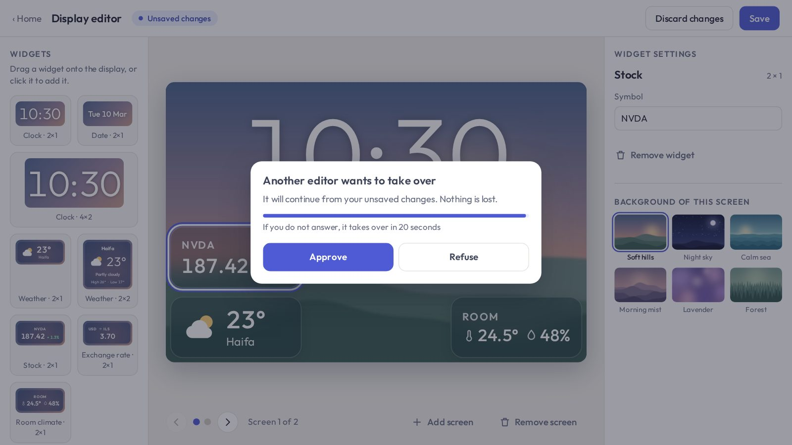 | 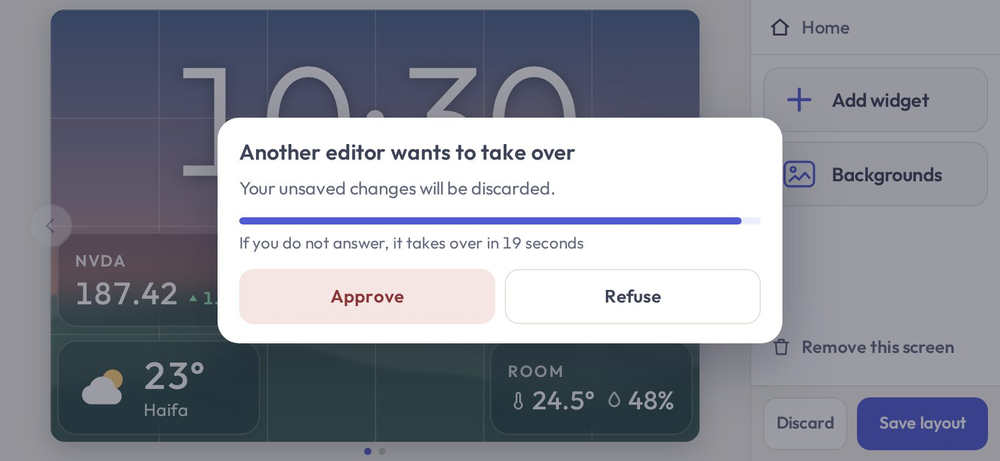 |

The timer warns as it runs out. Its bar turns amber when half the time is left, and maroon,
pulsing, for the last quarter:

| Half the time left | The last quarter |
|---|---|
| 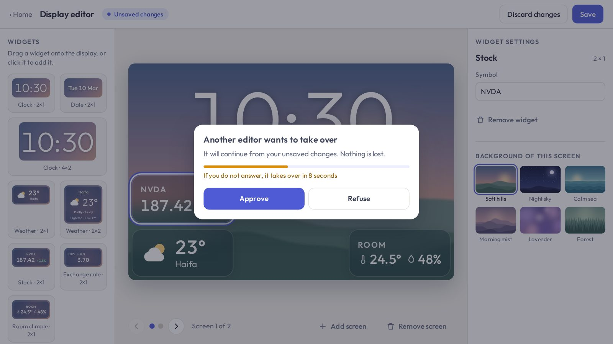 | 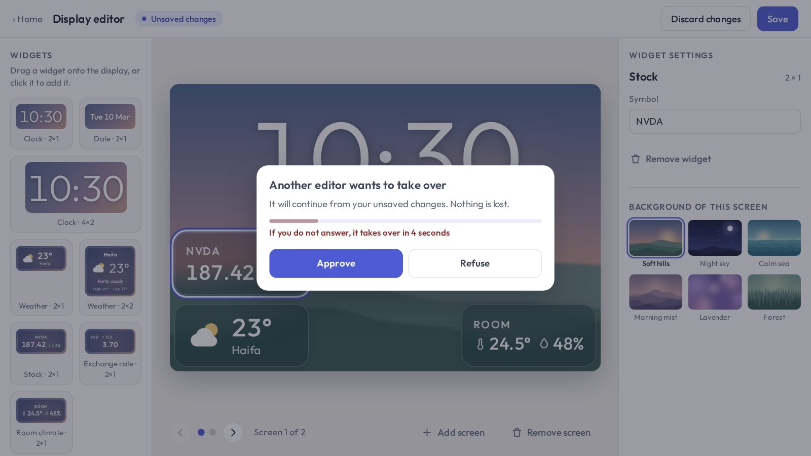 |

Only the first editor's timer changes colour. For the editor that is waiting, the time
running out is good news, so its bar stays as it is.

When the take-over has happened, the first editor is told what became of its work:

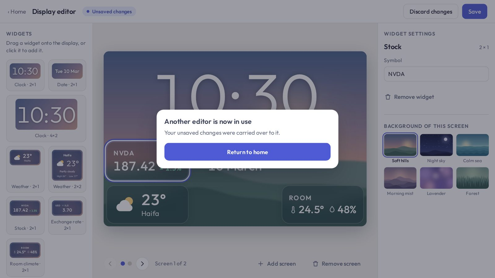

### Unsaved work was left behind

The tab was closed, the battery died, or the connection dropped. The next time the editor is
opened, it asks:

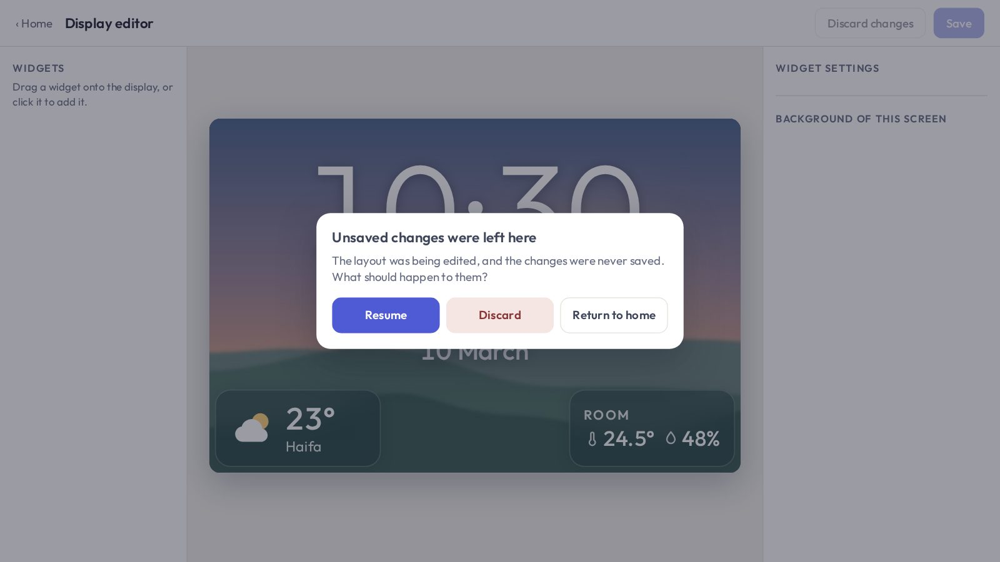

### The connection is lost

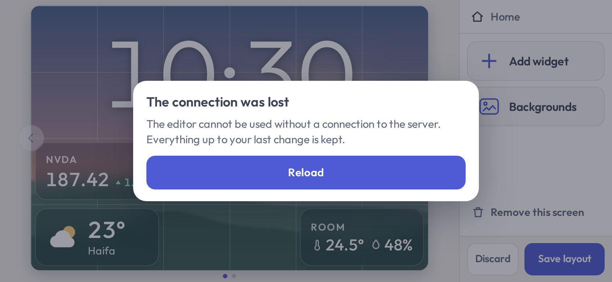

### Leaving with unsaved work

The Home button asks, in both editors. There are three ways to leave, each with a line that
says what happens, and three ways to stay that all do the same: the quiet line under the
buttons, the X, and a click beside the dialog.

| On a laptop | On a phone |
|---|---|
| 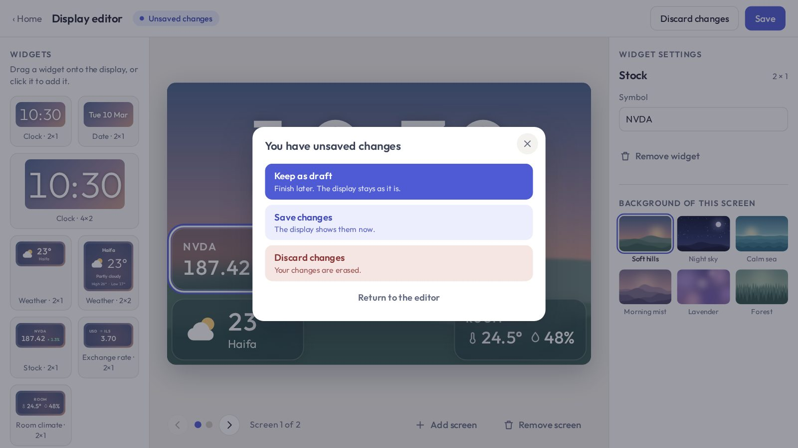 | 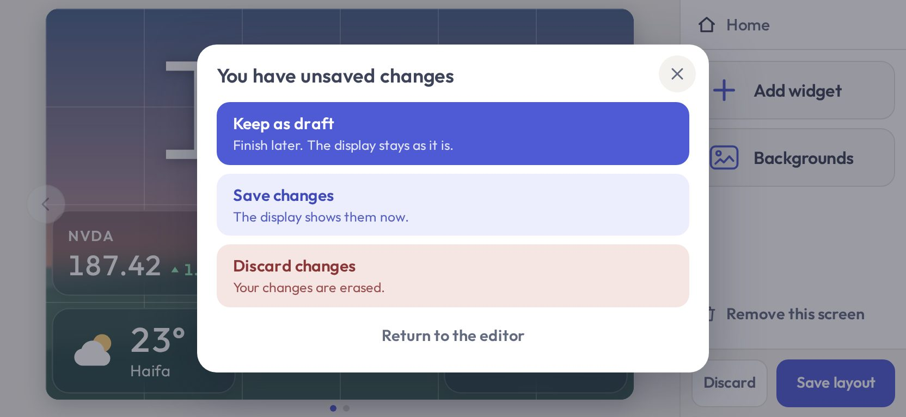 |

## Why these rules

**Nothing unsaved: take over at once.** There is no risk, because there is nothing to lose. It
is also most likely a forgotten editor: someone who opened the editor and has not changed one
thing is rare, and even then nothing is lost.

**Unsaved work: ask, with a timer.** The timer is what lets one rule serve both scenarios:

- If someone is editing right now (scenario 1), they see the question and can refuse. Their
  work is untouched.
- If the editor was forgotten (scenario 2), nobody answers, the timer runs out, and the new
  editor is not stuck.

**Continue or discard.** A person who started on one machine and wants to finish on another
keeps their work. A person who only tried things out, and did not mean them, can drop it.

**The draft on the server.** Taking over someone's unsaved work only works if that work can be
reached. Kept inside the old page, it could only be handed over while that page was awake: a
laptop with its lid closed could hand over nothing. Kept on the server, it is always there. It
also means that a closed tab or a power cut no longer loses work.

**Stopping on a lost connection.** An editor that keeps working without a connection collects
changes that never reach the draft. That is how work gets lost, so the editor does not allow
it. And it does not wait for the connection to return: by then someone else may have opened
the editor. Reloading turns the question "who is the editor now?" into a case that the rules
above already answer.

**A sleeping phone gives up the editor.** A phone that goes to sleep loses its connection, and
so its hold on the editor. We want that. Nobody should hoard the editor while others may need
it. Someone who is editing keeps their phone awake by using it; someone who is not gives the
editor up, and their unsaved work waits on the server until it is resumed or discarded.

**Keeping the draft is the default when leaving.** With the draft on the server, leaving no
longer has to mean "save or lose". Someone who leaves in the middle keeps their work for
later, and the display goes on showing the saved layout. The question on leaving is also a
reminder for someone who forgot that something is unsaved. Closing the tab asks nothing: a
browser gives a page no dialog of its own at that moment, and nothing is lost by it.

## How it is built, in short

- **The server keeps the rules.** It knows which editor is the one in use, keeps the draft in
  a file next to the saved layout, and runs the timer. Only the editor in use may change the
  draft, save or discard; everyone else is refused. A page cannot go around the rules,
  because the server has no other way to save a layout.
- **To the server, an editor is its live connection.** Each page keeps one connection open to
  the server, on which the server sends news and a short "nothing happened" message every two
  seconds. An editor is given its identity when that connection opens, and stops existing
  when it closes. So the server never has to guess whether the other editor is still there,
  and a reloaded page is a new editor by construction.
- **The page notices a lost connection in two ways:** a change that could not be sent, or
  about six seconds with nothing at all from the server.
- **Both editors share the code** for all of this: the messages, the dialog, and the
  conversation with the server are written once, and each editor only gives the dialog its
  place on the screen.

## Edge cases, and what happens in each

| Case | What happens |
|---|---|
| An editor was forgotten in another tab, with nothing unsaved | The new editor takes over at once |
| An editor was forgotten with unsaved work | The new editor asks to take over; nobody answers; when the timer runs out it takes over, with that work or without it, as it chose |
| Someone is actively editing and another person opens the editor | The person editing is asked, and can refuse. The other is told |
| The tab with unsaved work was closed | The draft is on the server. The next editor is asked whether to resume or discard it |
| A power cut, or a dead battery, in the middle of editing | The same: the draft is on the server |
| The server itself is restarted | The draft is in a file, so it is still there. The open editors say that the connection was lost |
| The internet connection drops while editing | The editor stops and says so. After a reload, the draft is resumed |
| A phone went to sleep in the middle of editing | Its connection dropped, and it no longer holds the editor. On waking it says that the connection was lost, and after a reload the draft can be resumed |
| Another editor took over while the phone was asleep | On waking, the phone says that the connection was lost. After a reload it is a new editor, and meets the one that took over by the same rules |
| An editor that is no longer the one in use tries to save | The server refuses: only the editor in use can save or change the draft |
| The person switches from the laptop to the phone on purpose | On the phone: take over and continue. The laptop is told, or times out |
| A third editor opens while a take-over is waiting for its answer | It is told to try again in a moment |
| The editor that asked to take over leaves while it waits | The question disappears from the first editor, which goes on editing |
| The first editor closes while it is being asked | Nobody is left to answer, so the new editor is not kept waiting: it takes over at once |
| The first editor saves, or leaves, between the new editor's question and its choice | The choice is followed as far as it still makes sense: what was saved is never touched, and a draft that was left is continued or discarded as chosen |
| Two editors are both asked about the same leftover draft | The first to choose gets the editor. The second is told the situation as it is by then |
| The page is reloaded | The old page tells the server that it is leaving, so the reloaded page does not meet itself as "another editor" |
| A browser is killed and cannot say that it is leaving | The server notices within about two seconds. An editor opened in that moment is told that another editor has unsaved changes; whatever it chooses happens at once, because nobody is left to ask |
| The answer arrives just after the timer ran out | It is too late, and changes nothing. The editor is told what happened |
| The question appears while the user is typing | The keys do not reach the editor behind the dialog, and cannot press one of its buttons by accident |
| A change is made back to exactly the saved layout | Nothing is unsaved any more, so the draft is erased and the next editor is not held up by it |

## How it is tested

- **The rules,** on the server, with a clock that the tests move: every row of the tables
  above, without waiting for the timer.
- **The page's part,** with a stand-in server: what it sends, in which order, and what it
  shows for every answer.
- **The whole thing in a real browser,** with two and three editors open at once: two
  laptops, a phone and a laptop, several phones. This includes letting the timer run out and
  stopping the server in the middle of editing.

## What we considered and did not choose

| Alternative | Why not |
|---|---|
| Let any number of editors work, refuse a Save that started from an older version, and ask the person which of the two layouts to keep | The person is asked to choose between two layouts they cannot compare. Unsaved work also stays inside each page, where it can be lost |
| One editor at a time, with a lock that cannot be taken over | A forgotten tab would lock its owner out |
| One draft that several editors change together, live | Far more to build and to get right, for a case that is rare with one display and a few users |
| The browser's own "leave this page?" question when a tab is closed | Its wording cannot be changed, and it would say that changes may be lost, which is no longer true. It is also unreliable on phones |

## What this does not cover

- **Who the other editor is.** The messages say "another editor", and nothing more.
- **Changes that are saved the moment they happen,** such as marking a task as done. Nothing
  there is unsaved, so the pages simply update. That is handled separately.
- **Someone who means harm.** The rules assume good will.
